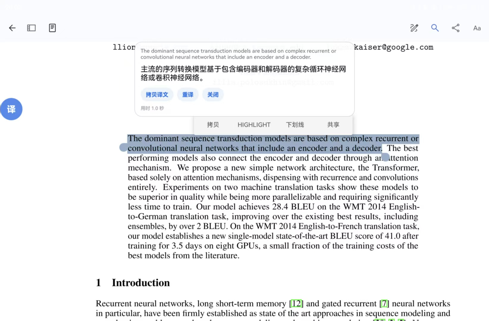

# XuanFuYi · 悬浮译

[English](README.md) | [中文](README.zh-CN.md)

A tiny floating translator for HarmonyOS and Android tablets, built for reading foreign-language
papers in Zotero.

Select text with a stylus, tap Copy, then tap the floating bubble. The translation shows up in a
floating card on top of Zotero, ready to paste back into your notes.



- No account, no telemetry. The app never modifies Zotero data, it only reads whatever you already copied.
- Two engines: free public endpoints (zero setup) or any OpenAI-compatible service (better quality, your own key).
- The key stays on your device. Nothing is bundled with this app.
## Install

Grab `dist/悬浮译.apk`, copy it to the tablet and install it. Android 8.0 and newer (minSdk 26).

HarmonyOS needs a few extra permissions before the bubble will work. The full walkthrough is in the
Chinese guide [`安装与使用说明.md`](安装与使用说明.md):

- Display over other apps (overlay) - required for the floating bubble
- Background pop-up and background activity (Huawei-specific)
- App launch management, switch to manual: allow auto-start, associated start and background activity
- Battery optimization, set to unrestricted
- Notifications

## How to use

1. Select a word, a sentence or a paragraph in Zotero with the stylus.
2. Tap Copy in the pop-up menu.
3. Tap the blue 译 bubble on screen.
4. A card appears with the source text and the translation, plus Copy translation / Retry / Close.

Extras:

- Drag the bubble to move it out of the way, long-press it to open the settings screen.
- Bubble size, card width and translation font size are all adjustable in settings.
- Text can also be sent through the Android share sheet.
## Translation engines

Free public endpoints (default): MyMemory first, with Google public endpoint as a fallback.
No sign-up needed, but shorter text works best and quality is average.

OpenAI-compatible service: works with any provider that speaks the OpenAI chat API.

| Field | Example |
| --- | --- |
| Base URL | https://api.deepseek.com/v1 or https://tokendance.space/gateway/v1 |
| Key | your own key from that provider |
| Model | deepseek-chat, glm-4.5-air, qwen3.5-flash |

The Base URL must point at the version root, the app appends /chat/completions itself.

Responses are streamed, so the first words appear in about a second, and the card shows how long the
request took. Small "flash" class models are the quickest choice for translation. Models named max
or pro, and models that run a thinking pass first, are several times slower for little gain.
## Build from source

Requirements: Windows with PowerShell 5.1 or newer, plus JDK 8 or newer (the script reads JAVA_HOME).
No Android Studio, no Gradle and no SDK install needed.

```powershell
# 1) download the Android build tools (about 120 MB)
powershell -ExecutionPolicy Bypass -File fetch-tools.ps1

# 2) build, the result lands in dist\悬浮译.apk
powershell -ExecutionPolicy Bypass -File build.ps1
```

If JAVA_HOME is not set:

```powershell
$env:JAVA_HOME = "C:\develop\jdk-21"
```

Already have an Android SDK? Point the script at your own toolchain instead of downloading:

```powershell
build.ps1 -BuildTools "D:\sdk\build-tools\34.0.0" -AndroidJar "D:\sdk\platforms\android-34\android.jar" -R8Jar "D:\sdk\r8.jar"
```

Signing: builds are signed with keystore/xuanfuyi.keystore (alias lingo, store password 123456), which
is created automatically if missing and is git-ignored. Keep that file safe. Android refuses to
install an update signed with a different key, so if you lose or replace it, existing users have to
uninstall the old version first. For anything beyond personal use, use your own keystore and pass
-KsPath, -KsAlias and -KsPass.

## Project layout

- app/AndroidManifest.xml - permissions and component declarations
- app/res/ - app name and launcher icons
- app/src/com/lingo/bubble/Prefs.java - settings storage
- app/src/com/lingo/bubble/Translator.java - translation engines (free endpoints plus OpenAI-compatible, SSE streaming)
- app/src/com/lingo/bubble/BubbleService.java - foreground service: floating bubble and result card
- app/src/com/lingo/bubble/ClipActivity.java - transparent activity that reads the clipboard when Android blocks background access
- app/src/com/lingo/bubble/ShareActivity.java - receives text from the share sheet
- app/src/com/lingo/bubble/MainActivity.java - settings screen
- app/src/com/lingo/bubble/BootReceiver.java - optional start on boot
- dist/ - prebuilt APK
- 安装与使用说明.md - complete Chinese install and usage guide

## Privacy

Selected text is sent only to the engine you pick: the public translation endpoints, or, for the
OpenAI-compatible option, whichever provider or relay your Base URL points at. No analytics, no
tracking, no account.

## Known limitations

- Direction is automatic: text containing CJK characters is translated into English, anything else into Chinese.
- A single request is capped at 4000 characters.
- The free endpoints occasionally rate-limit or fail on long text.
- HarmonyOS closes background apps quite aggressively. If the bubble keeps disappearing, re-check the launch management settings.

## License

MIT, see [LICENSE](LICENSE).